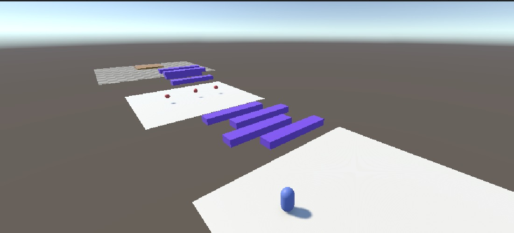
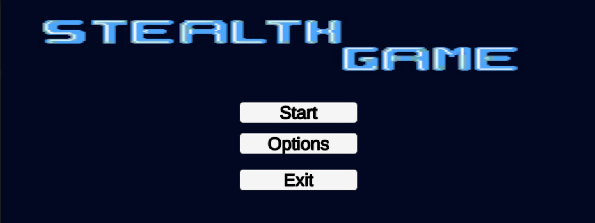
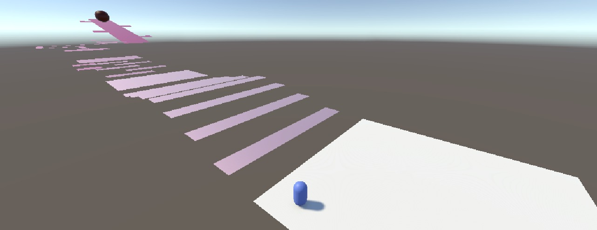
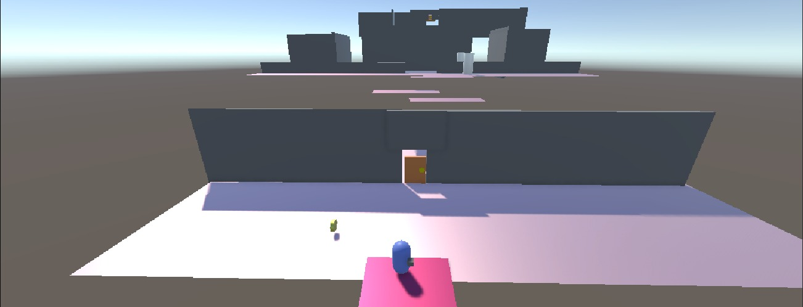
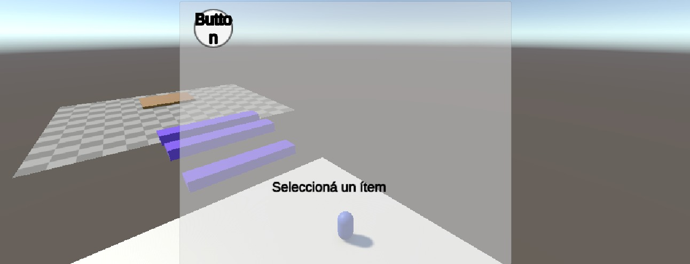
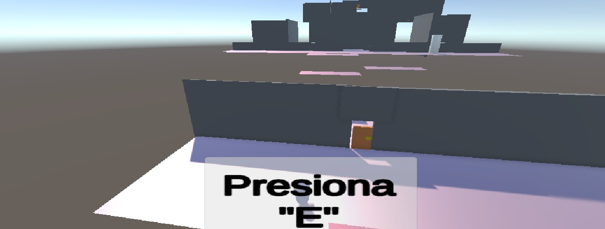
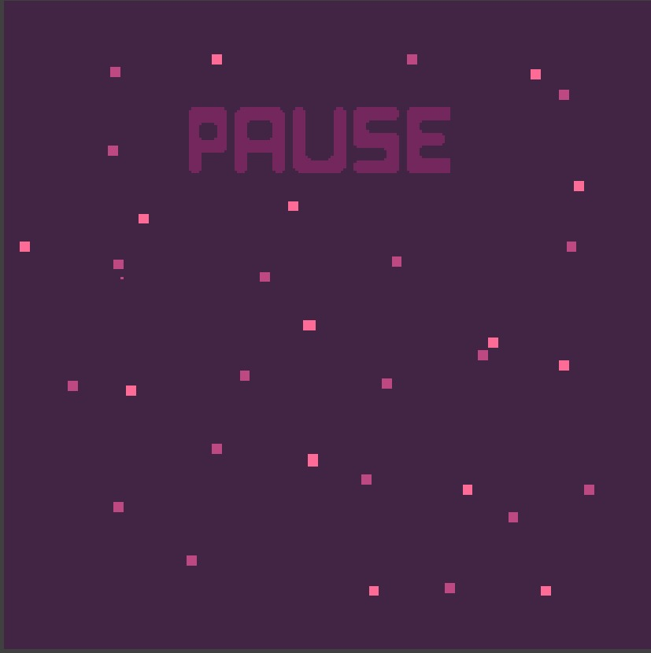
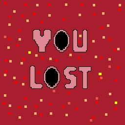

# ErmAcshuallyStudios · Prototipo "Sci-Fi Parkour & Infiltración"

**Trabajo Práctico Nº 3** de *Programación de Videojuegos I* (TUDIVJ, Facultad de Ingeniería, UNJu)

**Estudio:** ErmAcshually Studios · **Repositorio:** `ErmAcshuallyStudios_TP3_PVJ1`

**Versión de Unity:** _Unity 6.5_ · **Modalidad:** Opción A · Remake (evolución del TP2)



## Desarrolladoras

| Nombre y Apellido | Usuario de GitHub | LU |
|---|---|---|
| Esmeralda González Tolay | _LilEsme87_ | TUV000821 |
| Estefani Mamaní |  _Yohaneaaa_ |  _TUV000820_ |
| Santiago José Chosco |  _Santi1245_ |  _47241615_ |
| Tamara Melisa Quispe |  _tamaraunj_ |  _TUV000679_ |
| Cecilia Yazmin Tactaca |  _yaztac_ |  _TUV000764_ |
| Florencia Itati Quispe |  _kevinario21_ |  _TUV000805_ |

## Descripción del juego

Prototipo 3D de **parkour e infiltración con temática sci-fi**, pensado como respuesta a la carta de encargo de *Team17*. La partida se divide en tres escenas jugables conectadas entre sí:

1. **Tutorial (exterior):** Aprende a moverse, saltar, recoger objetos y usar el inventario, e interactúa con elementos del mapa que le muestran pistas. Para avanzar debe entrar a una estructura que funciona como portal al primer nivel.
2. **Nivel 1 (parkour):** dentro de la estructura, el jugador atraviesa plataformas (algunas móviles) y esquiva un **objeto dañino que cae**. Hay checkpoints para no perder todo el progreso.
3. **Nivel 2 (infiltración):** un área patrullada por un grupo de enemigos con **NavMeshAgent** que custodian una **llave**. Con la llave se abre la puerta de salida y se llega a la zona exterior final, que completa el juego.

**Objetivo:** completar los tres niveles sin que la vida llegue a 0. La **vida, el puntaje y el inventario se conservan** al cambiar de escena.

**Peligros:** objeto que cae (Nivel 1), enemigos que detectan por proximidad y golpean al jugador en cierto rango (Nivel 2).

**Ayudas:** checkpoints, ítems recolectables, power-up de invisibilidad y pistas emergentes.

### Flujo de escenas

```
Menú Principal ──► Tutorial ──► Nivel 1 ──► Nivel 2 ──► Victoria
      ▲                                         │            │
      └──────────── Pausa / Reiniciar ◄─────────┴─ Derrota ──┘
```

## Guía de controles

| Tecla | Acción |
|---|---|
| **W A S D** | Mover al personaje (relativo a la cámara) |
| **Espacio** | Saltar |
| **Flechas** | Girar la cámara (izquierda/derecha) y subirla o bajarla (arriba/abajo) |
| **E** | Interactuar (recoger objetos, usar terminales o puertas al apuntarlos de frente) |
| **Tab** | Abrir y cerrar el inventario |
| **P** o **ESC**| Pausar y continuar |
| **R** | Reiniciar tras la victoria o la derrota |

## Distribución de roles y ramas

Cada integrante trabajó en su propia rama personal y se integró a `main` mediante Pull Requests.

| Integrante | Rama | Rol | Scripts / recursos |
|---|---|---|---|
| Esmeralda González Tolay | `esmeralda-gonzalez` | **Nivel Tutorial:** mapa exterior con Terrain, movimiento del personaje, recolección de objetos e inventario utilizable en todos los niveles | `PlayerMovement`, `IMovementStrategy`, `CameraFollow`, `PlayerInteraction`, `IInteractable`, `ItemPickup`, `pickItem`, `ItemData`, `InventoryUI`, `InventorySlotUI`, `PlayerStats`, `HintData`, `HintTriggerZone`, `HintUIManager`, `MudZone`, `InvisibilityPowerUp`, escena `Tutorial` |
| Estefani Mamaní | `estefani-mamani` | **Nivel 1:** mapa de parkour, objeto que cae y script que mantiene inventario y vida | `PlayerHealth`, `MovingPlatform`, `Checkpoint`, prefab `objetoDanino`, escena `Nivel1` |
| Santiago José Chosco | `santiago-chosco` | **Nivel 2:** mapa de sigilo con enemigos, llave y puerta de salida | `Door`, `LevelGoal`, `LevelExitTrigger`, `Spawner`, escena `Nivel2` |
| Tamara Melisa Quispe | `tamara-quispe` | **IA enemiga:** detección por proximidad, persecución y golpe al jugador en rango | `EnemyAI`, `EnemyData`, prefab `Enemy` |
| Cecilia Yazmin Tactaca | `cecilia-tactaca` | **GameManager:** enum de estados, eventos por consola, pausa con ESC/P y enlace de victoria/derrota de cada nivel | `GameManager`, `SceneNames`, `SceneTransition` |
| Florencia Itati Quispe | `florencia-quispe` | **Interfaz:** menú de inicio, pausa, victoria y derrota, y la carpeta imagenes.| `MenuDerrota`, `MenuInicio`, `MenuOpciones`, `MenuSalir`, `MenuVictoria`, `UIManager`, `UIPanel` |

## Requisitos obligatorios

| Requisito | Implementación | Scripts / recursos |
|---|---|---|
| 1. Escenario base y control del personaje | Escena con punto de inicio, obstáculos, enemigos, objetos interactivos y zona de meta. Personaje con `Rigidbody` y `Collider`, cámara de seguimiento. Recursos organizados en carpetas | `PlayerMovement`, `CameraFollow`, `PlayerInteraction` |
| 2. Transición y persistencia de datos | Tres escenas conectadas con `SceneManager.LoadScene()`. Vida, puntaje e ítems se conservan entre niveles | `SceneTransition`, `SceneNames`, `LevelExitTrigger`, `PlayerHealth`, `PlayerStats` |
| 3. UI y flujo de escenas | Menú Principal en escena independiente (Iniciar, Créditos/Instrucciones, Salir), HUD con TextMeshPro, menú de pausa y paneles de Victoria y Derrota con reinicio | `MenuDerrota`, `MenuInicio`, `MenuOpciones`, `MenuSalir`, `MenuVictoria`, `UIManager`, `UIPanel`, `GameManager` |
| 4. Datos con ScriptableObjects | Estadísticas de jugador, enemigos e ítems fuera del código, editables desde el Inspector | Ver tabla de ScriptableObjects |
| 5. GameManager y control de estados | `enum GameState { Start, Playing, Paused, Victory, GameOver }`. Cada cambio de estado, la vida y el puntaje se informan por consola con `Debug.Log()`. La pausa congela el tiempo con `Time.timeScale` | `GameManager` |
| 6. Versionamiento con ramas | Una rama por integrante, mínimo 4 commits descriptivos cada una, integración a `main` con Pull Requests | Ver sección de Git |

### ScriptableObjects

| Archivo (`.asset`) | Tipo | Qué parametriza |
|---|---|---|
| `PlayerStats` | `PlayerStats` | Vida máxima, velocidad de movimiento, fuerza de salto y capacidad de inventario |
| `EnemyData_HallwayGuardian` | `EnemyData` | Enemigo que patrulla el pasillo |
| `EnemyData_KeyGuardian` | `EnemyData` | Enemigo que custodia la llave |
| `EnemyData_StationaryGuard` | `EnemyData` | Enemigo estático |
| `ItemData` | `ItemData` | Nombre, descripción e ícono del ítem |
| `MonedaData` | `ItemData` | Datos de la moneda recolectable |
| `HintKey` | `HintData` | Texto de la pista emergente |

**Comprobación:** al modificar un valor desde el Inspector, el comportamiento del personaje, del enemigo o del ítem cambia sin tocar el código C#.

### Detalles técnicos

- **Raycast + LayerMask:** el chequeo de suelo y la interacción a distancia usan `Physics.Raycast` filtrado por capa. La interacción funciona a través de la interfaz `IInteractable`.
- **NavMesh e IA:** cada nivel tiene su NavMesh horneado. Los enemigos usan `NavMeshAgent`, detectan al jugador por proximidad y le restan vida al golpearlo.
- **Eventos:** el jugador, los enemigos y los ítems notifican sus eventos (daño, recolección, muerte) y el `GameManager` reacciona con la acción correspondiente (pausa, cambio de escena, pantalla final, actualización del HUD).
- **Movimiento:** patrón *Strategy* (`IMovementStrategy`) sobre un `Rigidbody`.

## Detalle de opcionales elegidos

### Opción B · Sistema de pistas emergentes

Una caja de texto flotante en la UI se activa al entrar en zonas con triggers y muestra una pista cuyo contenido viene de un **ScriptableObject**.

- **Scripts:** `HintData.cs` (ScriptableObject con el texto), `HintTriggerZone.cs` (trigger que detecta al jugador) y `HintUIManager.cs` (muestra y oculta la caja de texto).
- **Cómo funciona:** al entrar en el trigger, `HintTriggerZone` le pasa su `HintData` a `HintUIManager`, que despliega el texto. Al salir, la caja se oculta.

### Opción E · Inventario

Panel emergente en la UI (tecla _Tab_) que muestra en casilleros los ítems recolectados. Al seleccionar uno se ven su ícono, nombre y descripción, cargados desde su **ScriptableObject**.

- **Scripts:** `ItemData.cs`, `ItemPickup.cs`, `InventoryUI.cs` e `InventorySlotUI.cs`, más el prefab `Slot`.
- **Cómo funciona:** al recoger un ítem se agrega su `ItemData` al inventario. `InventoryUI` instancia un `Slot` por ítem y `InventorySlotUI` muestra sus datos. El inventario persiste entre niveles.


## Capturas

### Menú Principal


### Tutorial


### Nivel 1 · Parkour


### Nivel 2 · Infiltración


### HUD e inventario



### Pista emergente


### Menú de pausa


### Victoria y Derrota




## Cómo abrir y ejecutar el proyecto

1. Clonar el repositorio:
   ```bash
   git clone https://github.com/kevinario21/ErmAcshuallyStudios_TP3_PVJ1
   ```
2. En **Unity Hub**: *Add > Add project from disk* y seleccionar la carpeta clonada.
3. Abrir el proyecto con la versión de Unity indicada arriba.
4. Abrir la escena del **Menú Principal** _Menu Inicio_ y presionar **Play**.

Las escenas deben estar en *File > Build Settings* en este orden: Menú Principal, Tutorial, Nivel1, Nivel2.

Si el NavMesh no se ve en alguna escena, se puede volver a hornear desde *Window > AI > Navigation > Bake*.

## Flujo de trabajo en Git

- Repositorio público `ErmAcshuallyStudios_TP3_PVJ1` con `.gitignore` de Unity desde el primer commit (se excluyen `Library/`, `Temp/`, `Logs/`, etc.).
- Una rama personal por integrante, nombrada con su nombre y apellido.
- Mínimo de 4 commits descriptivos por integrante.
- Integración a `main` mediante **Pull Requests**. La evidencia del trabajo en paralelo se puede ver en *Insights > Network* del repositorio.

## Estructura del proyecto

```
Assets/
  Materials/   Materiales de objetos, plataformas y enemigos
  Prefabs/     Enemy, objetoDanino, Checkpoint, Slot, FadePanel
  Scenes/      Tutorial, Nivel1, Nivel2 (y menú principal) con sus NavMesh
  Scripts/     Scripts en C#
    Enemies/           EnemyAI, EnemyData
    ScriptableObjects/ Archivos de datos (.asset)
  Settings/    Configuración de URP
  TextMesh Pro/
Packages/
ProjectSettings/
Screenshots/   Capturas usadas en este README
```
